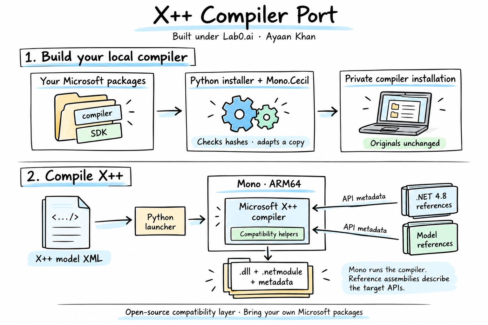

<div align="center">

# X++ Compiler for macOS

### Compile native X++ models on Apple Silicon macOS.

**Built under [Lab0.ai](https://lab0.ai)** · **Ayaan Khan** · [ayaan.khan2812@gmail.com](mailto:ayaan.khan2812@gmail.com)

[Team setup](docs/team-setup.md) · [Microsoft packages](docs/microsoft-packages.md) · [Architecture](docs/architecture.md) · [Compiler tests](docs/validation.md) · [Troubleshooting](docs/troubleshooting.md)

**Apple Silicon** · **Mono 6.14.1** · **Compiler 7.0.8199.55** · **MIT original source**

</div>



An open-source compatibility layer for running Microsoft's managed X++ compiler on a Mac. It accepts native model XML metadata and produces assemblies, modules, and model metadata using the actual Microsoft compiler.

**Bring your own Microsoft compiler and SDK packages.** This repository contains the adaptation source, installer, launcher, dependency preparation, examples, and compiler checks. Microsoft binaries are not included or relicensed.

**Acquire once, reuse across your team.** Import downloaded Microsoft packages,
restore the pinned versions from your authorized feed, or install from a verified
private input bundle. The scripts prepare dependencies, build the port and run
the compiler checks. No manual DLL selection or Windows extraction is needed.
[Team setup →](docs/team-setup.md) · [Exact download locations →](docs/microsoft-packages.md)

> **Experimental · version-pinned.** Supports one checked compiler package and native ARM64 Mono. Compilation is verified with positive and negative fixtures and optional comparison against the original Windows compiler. Other package versions require their own adaptation and qualification.

## What it does

- Compiles the shipped class, inheritance, exception, container, table, `select`, form, and chain-of-command fixtures.
- Builds dependent models against another model's compiler output.
- Preserves your source metadata by compiling a staged copy in a fresh directory.
- Records diagnostics, input/output hashes, build time, CPU time, and peak compiler memory.
- Builds the compatibility helpers from source and verifies the original compiler package remains unchanged.

This is a **compiler toolchain**, not an application runtime. The entry point takes **model XML**, not a loose `.xpp` file. Windows PDB generation is unavailable.

## Quick start

### 1. Prerequisites

| Requirement | Selection |
| --- | --- |
| Mac | Apple Silicon; native `arm64` tools |
| Python | **3.9+**; tested with **3.12.14** |
| Mono and `mcs` | Native ARM64 **6.14.1** |
| Native compiler | Apple Clang / Xcode Command Line Tools |
| Mono.Cecil | **0.11.1.0**, normally included with Mono |
| Microsoft compiler | `Microsoft.Dynamics.AX.Platform.CompilerPackage` **7.0.8199.55**, exact pinned contents |
| SDK references | Platform BuildXpp **7.0.8199.55** and ApplicationSuite BuildXpp **10.0.2790.83** for the smoke profile |
| Target API definitions | .NET Framework **4.8**, reference-pack NuGet **1.0.3**; prepared by the helper |

The [setup guide](docs/setup.md) covers obtaining packages, directory layout, offline setup, and tool selection. The scripts do not install or upgrade system software.

### 2. Clone and install

```sh
git clone https://github.com/ayaankhan28/xppc-macos.git
cd xppc-macos

python3 tools/team_setup.py from-packages \
  --package-directory /path/to/downloaded-microsoft-packages
```

Get the three required `.nupkg` files from [Microsoft or your organization's
feed](docs/microsoft-packages.md). Already have extracted inputs? Use:

```sh
python3 tools/team_setup.py from-packages \
  --compiler-package /path/to/Microsoft.Dynamics.AX.Platform.CompilerPackage \
  --sdk /path/to/sdk-packages
```

Choose one route. Both prepare **368 framework files** and **265 exact model
reference files**, build the helpers, and install into `.local/toolchain`.
Four public NuGet downloads are SHA-256 pinned. Host tools are not installed.

Installation checks all **224 original package files**, builds the C#/C helpers, adapts a separate compiler copy, and runs six compiler fixtures plus framework/native checks. Two fixtures deliberately contain invalid source: their expected diagnostic failures count as passing tests. `--strict-references` rejects unresolved external-reference diagnostics in the fixtures.

Have an approved team bundle instead? [Install it offline with one command](docs/team-setup.md#teammate-install-the-bundle).
For manual dependency preparation, custom tool paths and larger reference sets,
see the [detailed setup guide](docs/setup.md).

### 3. Compile

```sh
.local/toolchain/bin/xppc-mac compile \
  --metadata examples/ReaOraclePlatform/Metadata \
  --model ReaOraclePlatform \
  --output .local/builds/platform-001
```

Use a **new output directory** for every build. The example includes a table, select, form, and chain-of-command extension; the checks verify compilation, not execution of their application behavior.

```text
.local/builds/platform-001/
├── request.json                 Selected arguments and input hashes
├── result.json                  Status, diagnostics, costs and output hashes
├── metadata/                    Staged source and compiler caches
├── logs/                        Text, XML and process logs
├── asts/                        Compiler AST output
└── out/ReaOraclePlatform/bin/    Assemblies, modules and model metadata
```

For another model, use its metadata root and descriptor's `ModelModule`. Add dependencies with repeatable `--reference-folder` options. [Usage and dependent-model examples →](docs/setup.md#compile-your-own-model)

## How it works

The compiler's core is managed **.NET IL**. **Mono** executes those instructions on the Mac. Compatibility helpers adapt the Windows-specific boundaries: directory access, memory reporting, tracing, path handling, reflection, and framework discovery.

**Mono.Cecil** reads and rewrites selected instructions in a private copy of the compiler assemblies. The original package stays unchanged. This is an adaptation of Microsoft's compiler, not a new X++ parser or an X++-to-C# translator.

**.NET Framework 4.8 references** are the target API catalogue. Think of Mono as the workshop where the architect works, and reference assemblies as the building specifications the architect must follow. Mono runs the compiler; the references describe which types and methods the resulting program may use. They are not the runtime implementations.

| Source | Purpose |
| --- | --- |
| `tools/team_setup.py`, `package_inputs.py` | Import Microsoft packages, create/verify private input bundles and run setup |
| `tools/restore_microsoft.py`, `microsoft-packages.json` | Restore exact versions through your existing authorized NuGet feed |
| `tools/prepare_dependencies.py` | Stage locked target references from public downloads and supplied SDKs |
| `install.py` | Verify inputs, build helpers, create the private installation |
| `src/Port.cs` | Check compiler instruction shapes and apply IL adaptations |
| `src/Compatibility.cs`, `HostReflectionResolver.cs` | Host reflection and platform compatibility |
| `src/FrameworkResolver.cs`, `FrameworkTypeResolver.cs` | Resolve target framework identities and types |
| `src/compat.c` | Native macOS access and physical-memory probes |
| `bin/xppc-mac` | Python CLI for integrity checks and recorded builds |
| `examples/`, `tests/` | Minimal model fixtures and compiler verification |

[Architecture details →](docs/architecture.md)

## Tests

Public source checks run without Microsoft packages:

```sh
python3 -m unittest discover -s tests -p 'test_*.py' -v
python3 tools/check_public_tree.py
```

GitHub Actions runs these checks. Real compiler verification requires your licensed inputs and runs automatically through team setup, or explicitly through `install.py --verify`. Independently supplied Windows outputs can additionally enable structural artifact and diagnostic comparison. [Test guide →](docs/validation.md) · [Release verification →](reports/release-validation.json)

The team setup update passed **23 public tests** and fresh installations through
both existing-package and offline-bundle routes, with all six compiler fixtures
passing in each. Live private-feed authentication was not exercised.
[Team setup verification →](reports/team-setup-validation.json)

## License and authorship

Original source, fixtures, tests, documentation, and illustration: **[MIT](LICENSE)**. Microsoft and third-party dependencies retain their own licenses; see [third-party notices](THIRD_PARTY_NOTICES.md).

**Built under [Lab0.ai](https://lab0.ai)**

**Author: Ayaan Khan** · [ayaan.khan2812@gmail.com](mailto:ayaan.khan2812@gmail.com)

Independent experimental software. [Contributions →](CONTRIBUTING.md)
